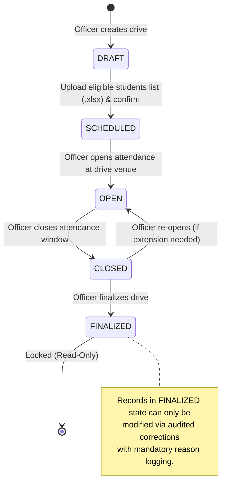
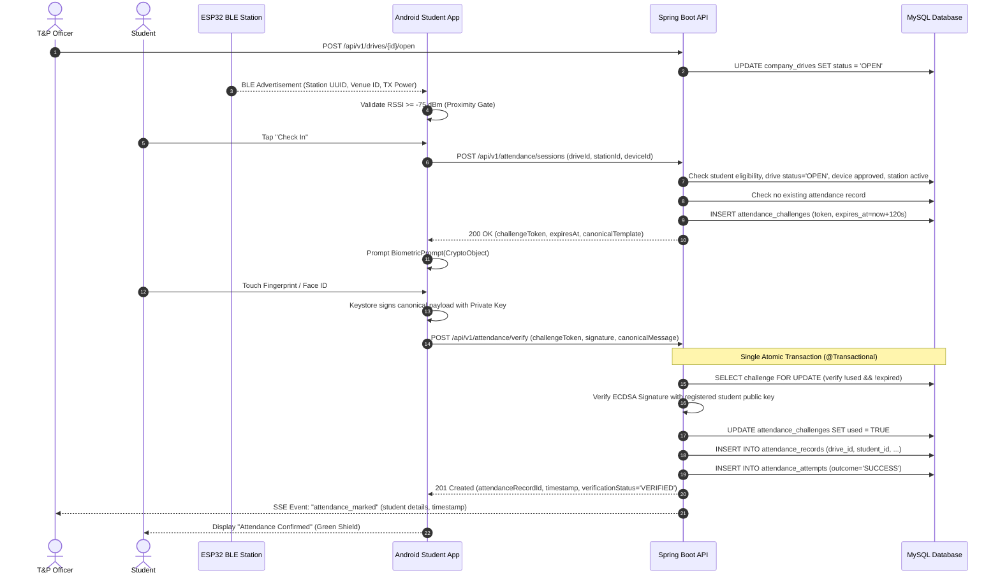

# System Architecture & Design Specification

## 1. System Overview
The Biometric Placement Drive Attendance System is designed for college Training & Placement (T&P) departments to eradicate proxy attendance during on-campus recruitment drives.

The system replaces shared spreadsheets with:
1. **Excel-Only Data Flow**: Strictly validated `.xlsx` import for drive eligibility (OOXML format verification, Apache POI zip-bomb protection, per-row validation against master data, downloadable preview and rejected rows). Audited `.xlsx` exports with SXSSFWorkbook, formula-injection sanitization, and database count parity.
2. **Cryptographic & Biometric Attendance Proof**: Native Android app using Android Keystore (hardware-backed SecP256r1 / ECDSA) bound to `BiometricPrompt` via `CryptoObject`. Every attendance check-in signs a single-use, server-generated, short-lived challenge.
3. **Physical Proximity Verification**: BLE stations (ESP32) broadcasting station identity at drive venues. The app confirms radio proximity before requesting an attendance challenge.
4. **Officer Console**: Real-time React dashboard with Server-Sent Events (SSE), drive lifecycle management, student search, audit logs, and audited attendance correction workflows.
5. **Zero-Trust Backend**: Spring Boot 3.x, Java 21, MySQL 8, Flyway, enforcing strict role-based access control, transaction isolation, and protection against race conditions and IDOR.

---

## 2. High-Level Component Architecture (C4 Container View)

```
+-----------------------------------------------------------------------------------------+
|                                 PLACEMENT DRIVE VENUE                                    |
|                                                                                         |
|  +---------------------+                                +----------------------------+  |
|  |   ESP32 BLE Station | --- BLE Beacon Broadcast ----->|     Student Android App    |  |
|  |  (Venue Proximity)  |     (UUID, Major, Minor, RSSI) | (Keystore + BiometricPrompt|  |
|  +---------------------+                                +-------------+--------------+  |
+-----------------------------------------------------------------------|-----------------+
                                                                        | HTTPS (TLS 1.3)
                                                                        | REST API (/api/v1)
                                                                        v
+-----------------------------------------------------------------------------------------+
|                               COLLEGE PRIVATE CLOUD / SERVER                            |
|                                                                                         |
|  +---------------------+        HTTPS        +---------------------------------------+  |
|  |   T&P Officer Web   |-------------------->|       Spring Boot 3.x Backend         |  |
|  |   Portal (React +   |  (REST + SSE Live)  |  - Security & JWT Auth Filter         |  |
|  |   Tailwind + Vite)  |                     |  - Drive Lifecycle Manager            |  |
|  +---------------------+                     |  - Excel Engine (POI / SXSSF)         |  |
|                                              |  - Challenge & Crypto Verifier        |  |
|                                              |  - Audit & Event Publisher            |  |
|                                              +-------------------+-------------------+  |
|                                                                  |                      |
|                                                                  | JDBC (HikariCP)      |
|                                                                  v                      |
|                                              +---------------------------------------+  |
|                                              |            MySQL 8 Database           |  |
|                                              |  (Flyway Migrations, Strict FKs,      |  |
|                                              |   Unique Constraints, Read Committed) |  |
|                                              +---------------------------------------+  |
+-----------------------------------------------------------------------------------------+
```

---

## 3. Core Modules & Responsibilities

### 3.1 Backend (`placement-attendance/backend`)
- **Technology**: Java 21, Spring Boot 3.3+, Spring Security 6, Spring Data JPA, Hibernate, Flyway, Apache POI 5.3+, Springdoc OpenAPI 2.6+.
- **Sub-modules**:
  - `auth`: JWT issuance, refresh tokens, role enforcement (`ROLE_OFFICER`, `ROLE_STUDENT`).
  - `excel`: Strictly validates `.xlsx` (magic bytes, POI ZipSecureFile, schema validation), streaming SXSSF export, formula escaping (`=`, `+`, `-`, `@`).
  - `drive`: Lifecycle machine (`DRAFT` -> `SCHEDULED` -> `OPEN` -> `CLOSED` -> `FINALIZED`), eligibility mapping.
  - `device`: Device enrollment, public key binding, officer approval, device revocation.
  - `attendance`: Session token generation, cryptographic challenge issuance, ECDSA signature verification, idempotent single-transaction check-in (`UNIQUE(drive_id, student_id)`).
  - `audit`: Immutable logging of every sensitive action (exports, corrections, revocations, failed verifications).
  - `sse`: Real-time attendance streaming to officer dashboard.

### 3.2 Officer Portal (`placement-attendance/frontend`)
- **Technology**: React 18, TypeScript, Vite, Tailwind CSS, shadcn/ui design tokens, TanStack Query v5, React Hook Form, Zod.
- **Pages**:
  - Auth: Officer login with secure token storage.
  - Drives Dashboard: Drive creation, lifecycle state transitions, live attendance stats.
  - Excel Import Hub: Template download, drag-and-drop `.xlsx` upload, validation preview modal, row-by-row error inspector, confirm import, rejected rows `.xlsx` download.
  - Live Attendance Monitor: Real-time SSE feed, instant search, check-in timestamps, verification status badges.
  - Reports & Audits: Export `.xlsx` with custom sheets, audited corrections modal (mandatory reason logging), audit trail table.
  - Device Management: Student device approval queue, device revocation with audit trail.

### 3.3 Student Android App (`placement-attendance/android-app`)
- **Technology**: Kotlin 2.0+, AndroidX Biometric, Android Keystore API, Coroutines, StateFlow, Retrofit2, OkHttp3.
- **Security & Crypto**:
  - Hardware-backed keypair generation (`KeyGenParameterSpec`, `KeyProperties.PURPOSE_SIGN`, `DIGEST_SHA256`, `KEY_ALGORITHM_EC`, curve `secp256r1`).
  - `setUserAuthenticationRequired(true)`: Unlocks private key exclusively upon biometric presentation.
  - `CryptoObject` initialization: `Signature.getInstance("SHA256withECDSA")`.
  - Canonical message formatting: `SHA-256(challenge_id + ":" + student_id + ":" + drive_id + ":" + device_id + ":" + station_id + ":" + timestamp)`.
- **Proximity**:
  - BLE scanning using `BluetoothLeScanner` with version-aware Android permissions (`BLUETOOTH_SCAN`, `BLUETOOTH_CONNECT`, no location permission on Android 12+ / API 31+ with `neverForLocation`).
- **Dev/Mock Fallback**:
  - An explicit `BleStationScanner` interface with a `MockBleStationScanner` guarded by `BuildConfig.DEBUG` and disabled completely in production release builds.

### 3.4 BLE Station Firmware (`placement-attendance/ble-firmware`)
- **Technology**: ESP32 microcontroller, ESP-IDF / Arduino framework.
- **Protocol**: iBeacon / Custom BLE non-connectable advertising packet emitting:
  - System Proximity Service UUID (`0000FD5A-0000-1000-8000-00805F9B34FB`)
  - Venue / Station ID (`Major`: College Venue ID, `Minor`: Station Unit ID)
  - Calibrated TX Power for RSSI distance gating (-75 dBm cutoff threshold).

---

## 4. Drive Lifecycle State Machine



---

## 5. End-to-End Attendance Flow Sequence


